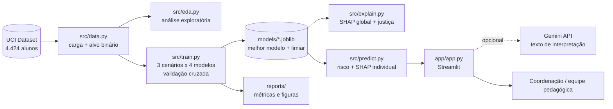
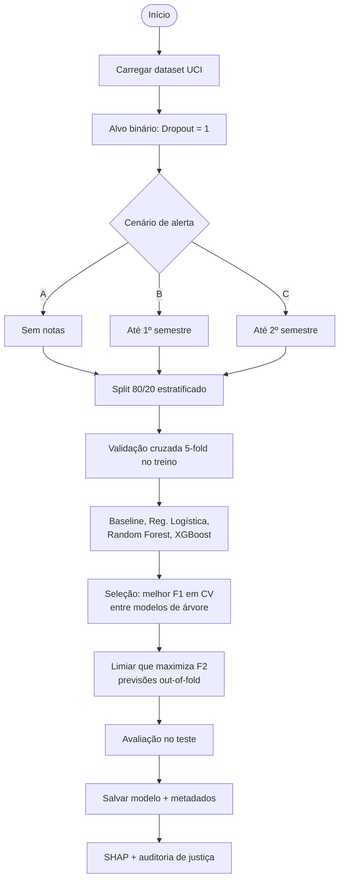
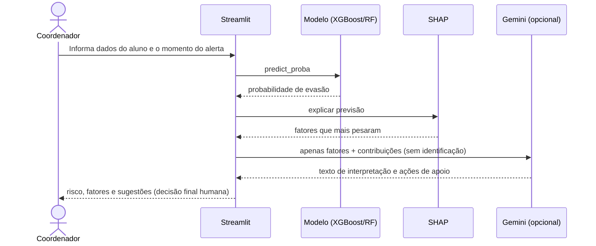

# Arquitetura da solução

## Visão geral

## Fluxo do pipeline de ML

## Fluxo de uso no aplicativo

## Decisões de projeto

| Decisão | Justificativa |
|---|---|
| Alvo binário (Dropout vs. demais) | Foco no que gera ação: identificar quem pode evadir |
| 3 cenários de antecedência | Mostra o trade-off entre precisão e tempo para intervir; evita "vazamento" de informação tardia |
| Modelos de árvore para implantação | Bom desempenho em dados tabulares e SHAP exato e rápido (TreeSHAP) |
| Limiar otimizado por F2 | Falso negativo (aluno em risco não detectado) é mais custoso que falso positivo |
| Auditoria de justiça | Atributos sensíveis não são regra de decisão, mas o desempenho por grupo é monitorado |
| LLM opcional e desacoplado | O sistema funciona sem serviço externo; privacidade preservada |
